<div align="center">


<br />

An agent skill and the film engine behind it. Ask your agent for an explainer on any topic, in any of sixteen
visual templates: it researches the facts, draws a storyboard, waits for your yes, then renders a 1080p60 film
frame by frame, with narration, music and sound.

<br />

[](https://github.com/zeative/motion-educator/stargazers)
[](https://github.com/zeative/motion-educator/actions/workflows/test.yml)


[](LICENSE)

**[Website](https://motionedu.kejaa.id)** · [Quick start](#quick-start) · [Templates](#visual-templates) · [Gallery](#gallery) · [How it works](#how-it-works) · [Docs](#docs)

<br />

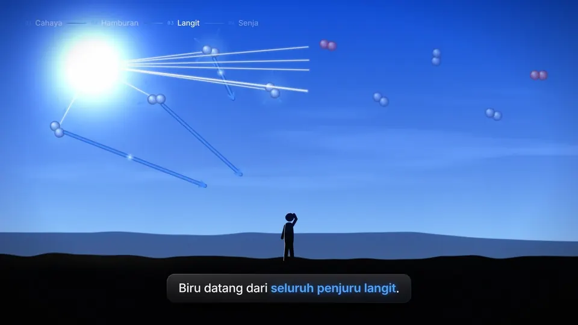

<sub>Moments from films made with the skill, each by an agent following it from the brief to the mix. Every frame is code: no stock footage, no video model.</sub>

</div>

<br />

## Highlights

<table>
<tr>
<td width="50%" valign="top"><b>Storyboard first.</b> Nothing is rendered until a drawn storyboard passes a checker and you have approved it. The board is the film's clock: shot times, captions and the chapter rail are read from it.</td>
<td width="50%" valign="top"><b>True, with sources.</b> Every number on screen sits in a fact sheet with its source and its arithmetic. A bar that stands for 5.9× is 5.9 times as tall.</td>
</tr>
<tr>
<td valign="top"><b>The real thing, a directed camera.</b> Devices, organs and machines are rebuilt from references and teardowns, then filmed like a product: orbits, push-ins, macro close-ups, parts lifting apart.</td>
<td valign="top"><b>Sixteen looks, any topic.</b> Photoreal 3D, motion graphics, claymation, chalk, blueprint, pixel art, watercolour and more. A template is a look, never a subject.</td>
</tr>
<tr>
<td valign="top"><b>Explains itself on mute.</b> Captions and pictures carry the lesson; one-take narration, a composed music bed and measured sound effects make it land.</td>
<td valign="top"><b>Graded by someone else.</b> Stills while building, measurements on the render, then a critic who did not build it. Fixes re-render four seconds, not the film.</td>
</tr>
</table>

## Quick start

Install it where your agent looks for skills:

```sh
git clone --depth 1 https://github.com/zeative/motion-educator ~/.claude/skills/motion-educator
```

Then ask for a film, or call the skill by name:

```
/motion-educator why a full trolley is harder to push, in the Stickman template, portrait, Indonesian
```

> Make a 45-second explainer on why the Moon always shows us the same face. Portrait, English, with narration.

A prompt copied from the [website](https://motionedu.kejaa.id) works the same way. The skill scaffolds a workspace
in your project, writes and draws the storyboard, and stops for your approval before it builds anything.

<details>
<summary><b>Other agents</b></summary>
<br />

It is a plain [Agent Skills](https://agentskills.io) folder (`SKILL.md`, `references/`, a Node kit), so any agent
that reads skills can use it. Clone it into the folder yours looks in:

| Agent | For you (all projects) | For one project |
| --- | --- | --- |
| Claude Code | `~/.claude/skills/motion-educator` | `.claude/skills/motion-educator` |
| OpenAI Codex | `~/.agents/skills/motion-educator` | `.agents/skills/motion-educator` |
| Gemini CLI | `~/.gemini/skills/motion-educator` | `.gemini/skills/motion-educator` |
| GitHub Copilot | `~/.copilot/skills/motion-educator` | `.github/skills/motion-educator` |
| Cursor | reads `~/.claude/skills` and `~/.codex/skills` | `.cursor/skills/motion-educator` |

An agent without skill support can still follow it: clone it anywhere and tell it to read `SKILL.md` first. It
needs a shell to run Node, FFmpeg and Python, and the ability to look at images, since it checks its own stills.
Every film here was made with Claude Code; the other agents are untested.

</details>

<details>
<summary><b>By hand, without an agent</b></summary>
<br />

```sh
git clone --depth 1 https://github.com/zeative/motion-educator && cd motion-educator
npm install && bash kit/audio/fetch.sh
node kit/tools/doctor.mjs                                     # is this machine ready?

node kit/tools/new.mjs ~/films moon-face --portrait           # a workspace and films/moon-face
node kit/tools/new.mjs ~/films trolley --template stickman     # or a film in a visual template
cd ~/films && npm install && bash kit/audio/fetch.sh
```

```sh
node kit/tools/storyboard.mjs films/moon-face --png           # 1. check the storyboard and draw the board
node kit/audio/voice.mjs films/moon-face --generate           # 2. one take, and the film cut to it (ELEVENLABS_API_KEY)
node kit/tools/render.mjs films/moon-face --stills 1.5,4.2    # 3. build, looking at stills as you go
node kit/tools/make.mjs films/moon-face                       # 4. render, mix, measure, a share copy
```

Requirements: Node 20+, FFmpeg, Python 3 with numpy, and Playwright's Chromium
(`npm i -D playwright && npx playwright install chromium`). Without a GPU on Linux it needs Mesa's software Vulkan
(`apt install mesa-vulkan-drivers`). `node kit/tools/doctor.mjs` checks all of it.

</details>

## Visual templates

A template is a look, never a topic: any subject can be made in any of them. The prompt names one, the storyboard
records it, and the engine applies it before the first frame: the stage, the type, the caption skin, the palette,
and for stop motion and drawings on twos, the rate the picture advances at.

<!-- templates:start -->
<table>
<tr>
<td align="center" valign="top" width="25%"><a href="templates/cutaway">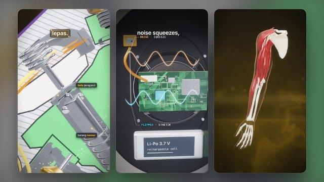</a><br /><b>Studio Cutaway</b><br /><sub>Photoreal 3D · 3 sample films</sub></td>
<td align="center" valign="top" width="25%"><a href="templates/glass">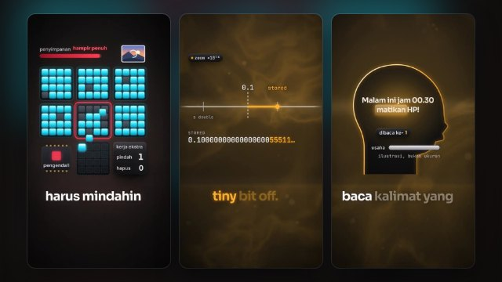</a><br /><b>Graphite Glass</b><br /><sub>Motion graphics · 4 sample films</sub></td>
<td align="center" valign="top" width="25%"><a href="templates/cosmos">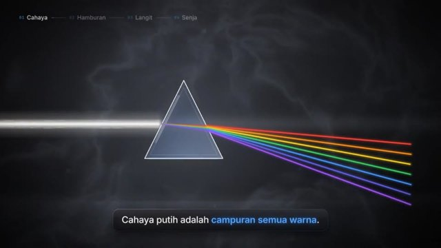</a><br /><b>Cosmos</b><br /><sub>3D and light · 4 sample films</sub></td>
<td align="center" valign="top" width="25%"><a href="templates/micro">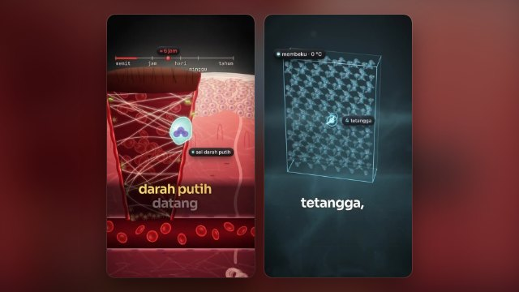</a><br /><b>Micro</b><br /><sub>Illustrated 3D · 2 sample films</sub></td>
</tr>
<tr>
<td align="center" valign="top" width="25%"><a href="templates/stickman">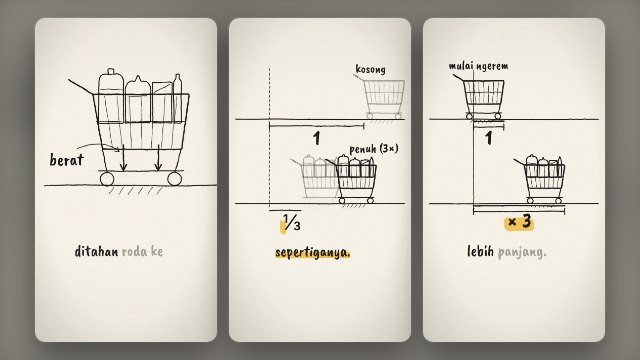</a><br /><b>Stickman</b><br /><sub>Hand-drawn 2D · 1 sample film</sub></td>
<td align="center" valign="top" width="25%"><a href="templates/clay">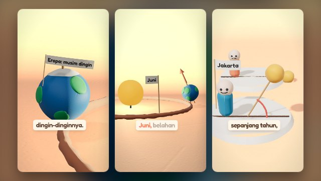</a><br /><b>Clay</b><br /><sub>Claymation · 1 sample film</sub></td>
<td align="center" valign="top" width="25%"><a href="templates/paper">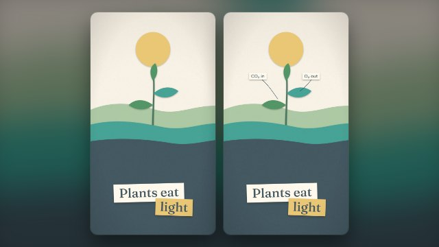</a><br /><b>Paper Cut-out</b><br /><sub>Layered paper · engine proof</sub></td>
<td align="center" valign="top" width="25%"><a href="templates/chalkboard">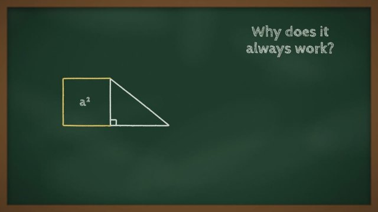</a><br /><b>Chalkboard</b><br /><sub>Chalk on board · engine proof</sub></td>
</tr>
<tr>
<td align="center" valign="top" width="25%"><a href="templates/blueprint">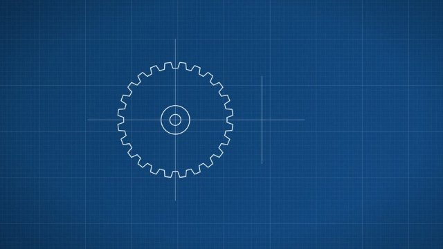</a><br /><b>Blueprint</b><br /><sub>Technical drawing · engine proof</sub></td>
<td align="center" valign="top" width="25%"><a href="templates/isometric">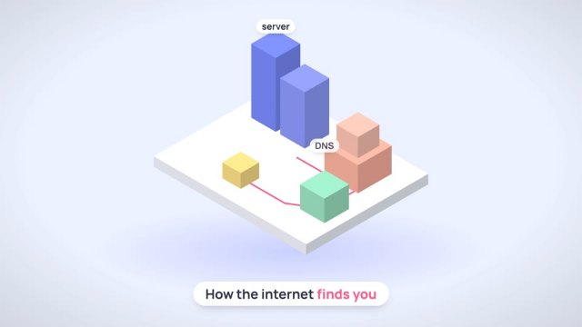</a><br /><b>Isometric</b><br /><sub>Isometric diorama · engine proof</sub></td>
<td align="center" valign="top" width="25%"><a href="templates/pixel">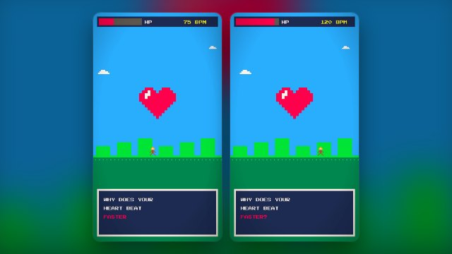</a><br /><b>Pixel</b><br /><sub>Pixel art · engine proof</sub></td>
<td align="center" valign="top" width="25%"><a href="templates/whiteboard">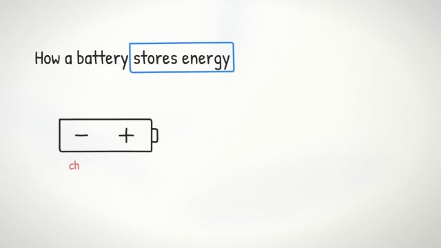</a><br /><b>Whiteboard</b><br /><sub>Marker sketch · engine proof</sub></td>
</tr>
<tr>
<td align="center" valign="top" width="25%"><a href="templates/watercolour">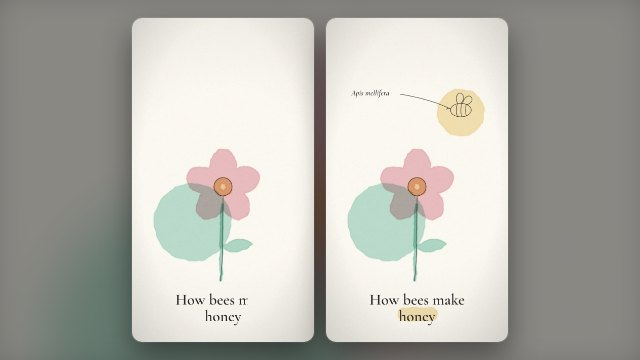</a><br /><b>Watercolour</b><br /><sub>Painted · engine proof</sub></td>
<td align="center" valign="top" width="25%"><a href="templates/neon">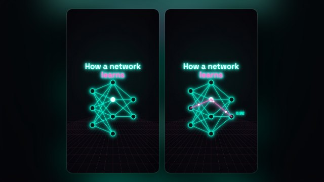</a><br /><b>Neon Line</b><br /><sub>Glowing lines · engine proof</sub></td>
<td align="center" valign="top" width="25%"><a href="templates/comic">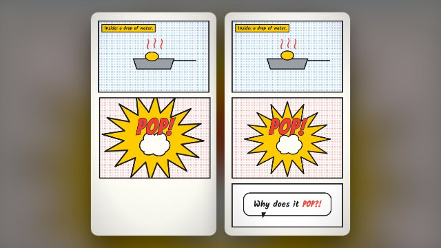</a><br /><b>Comic</b><br /><sub>Ink and halftone · engine proof</sub></td>
<td align="center" valign="top" width="25%"><a href="templates/lowpoly">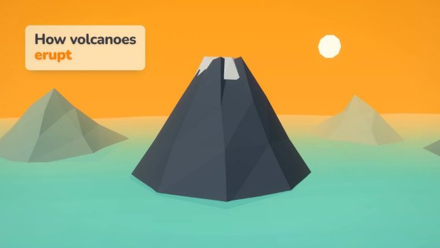</a><br /><b>Low Poly</b><br /><sub>Faceted 3D · engine proof</sub></td>
</tr>
</table>

<sub>Every card is real output: frames of the template's sample films, or of its engine proof (a few seconds made with the kit and matched to the template on every <code>lookmatch.mjs</code> measure) until its first sample film is done. 6 of 16 have sample films.</sub>
<!-- templates:end -->

Each lives in [`templates/<key>/`](templates): its lines (`template.md`), engine settings (`template.json`), type
and colours (`look.css`), and the golden stills a film is measured against by `kit/tools/lookmatch.mjs`
(background, ink, palette, lightness, colour, line, grain and drawing rate). New templates are made from a reference
video with [reanimate](https://github.com/NiazMorshed2007/reanimate)'s loop: [`references/templates.md`](references/templates.md).

## Gallery

<!-- gallery:start -->
**Explainers** (16:9)

<table>
<tr>
<td valign="top" align="center" width="300"><a href="docs/media/films/langit-biru.mp4"></a><br /><sub><a href="examples/langit-biru"><b>Kenapa langit berwarna biru?</b></a><br />Bahasa Indonesia · 67 s · captions · <a href="docs/media/films/langit-biru.mp4">▶ watch</a> · <a href="examples/langit-biru/storyboard">board</a></sub></td>
<td valign="top" align="center" width="300"><a href="docs/media/films/how-gps-works.mp4">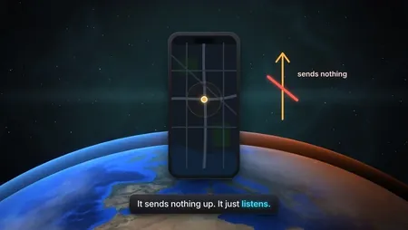</a><br /><sub><a href="examples/how-gps-works"><b>How does your phone know where you are?</b></a><br />English · 60 s · captions · <a href="docs/media/films/how-gps-works.mp4">▶ watch</a> · <a href="examples/how-gps-works/storyboard">board</a></sub></td>
</tr>
<tr>
<td valign="top" align="center" width="300"><a href="docs/media/films/why-seasons.mp4">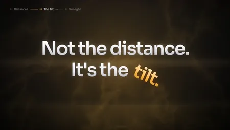</a><br /><sub><a href="examples/why-seasons"><b>Why do we have seasons?</b></a><br />English · 57 s · captions · <a href="docs/media/films/why-seasons.mp4">▶ watch</a> · <a href="examples/why-seasons/storyboard">board</a></sub></td>
<td valign="top" align="center" width="300"><a href="docs/media/films/bunga-majemuk.mp4"></a><br /><sub><a href="examples/bunga-majemuk"><b>Kok uang bisa beranak? Gimana bunga majemuk bekerja?</b></a><br />Bahasa Indonesia · 52 s · captions · <a href="docs/media/films/bunga-majemuk.mp4">▶ watch</a> · <a href="examples/bunga-majemuk/storyboard">board</a></sub></td>
</tr>
</table>

**Shorts** (9:16)

<table>
<tr>
<td valign="top" align="center" width="170"><a href="docs/media/films/noise-cancelling.mp4">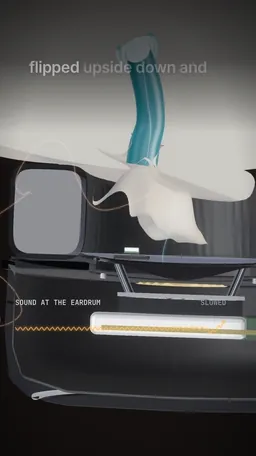</a><br /><sub><a href="examples/noise-cancelling"><b>How do noise-cancelling headphones erase sound?</b></a><br />English · 74 s · voice: Craig - Warm, Articulate, Conversational · <a href="docs/media/films/noise-cancelling.mp4">▶ watch</a> · <a href="examples/noise-cancelling/storyboard">board</a></sub></td>
<td valign="top" align="center" width="170"><a href="docs/media/films/kenapa-musim.mp4">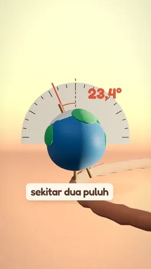</a><br /><sub><a href="examples/kenapa-musim"><b>Kenapa ada musim?</b></a><br />Bahasa Indonesia · 65 s · voice: Livna · <a href="docs/media/films/kenapa-musim.mp4">▶ watch</a> · <a href="examples/kenapa-musim/storyboard">board</a></sub></td>
<td valign="top" align="center" width="170"><a href="docs/media/films/luka-sembuh.mp4"></a><br /><sub><a href="examples/luka-sembuh"><b>Gimana sih luka bisa nutup sendiri?</b></a><br />Bahasa Indonesia · 53 s · voice: Livna · <a href="docs/media/films/luka-sembuh.mp4">▶ watch</a> · <a href="examples/luka-sembuh/storyboard">board</a></sub></td>
<td valign="top" align="center" width="170"><a href="docs/media/films/hoaks-diulang.mp4"></a><br /><sub><a href="examples/hoaks-diulang"><b>Kenapa hoaks yang diulang-ulang lama-lama terasa benar?</b></a><br />Bahasa Indonesia · 50 s · voice: Jefri · <a href="docs/media/films/hoaks-diulang.mp4">▶ watch</a> · <a href="examples/hoaks-diulang/storyboard">board</a></sub></td>
</tr>
<tr>
<td valign="top" align="center" width="170"><a href="docs/media/films/hp-lemot.mp4">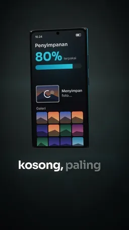</a><br /><sub><a href="examples/hp-lemot"><b>Kenapa HP makin lemot pas memorinya hampir penuh?</b></a><br />Bahasa Indonesia · 45 s · voice: Rafiq · <a href="docs/media/films/hp-lemot.mp4">▶ watch</a> · <a href="examples/hp-lemot/storyboard">board</a></sub></td>
<td valign="top" align="center" width="170"><a href="docs/media/films/troli-penuh.mp4">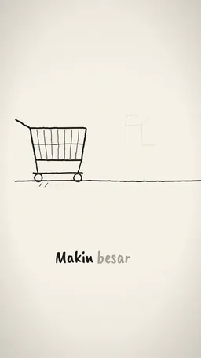</a><br /><sub><a href="examples/troli-penuh"><b>Kenapa troli penuh susah didorong?</b></a><br />Bahasa Indonesia · 41 s · voice: Rafiq · <a href="docs/media/films/troli-penuh.mp4">▶ watch</a> · <a href="examples/troli-penuh/storyboard">board</a></sub></td>
<td valign="top" align="center" width="170"><a href="docs/media/films/petir-guntur.mp4"></a><br /><sub><a href="examples/petir-guntur"><b>Kenapa petir terlihat dulu, baru guntur terdengar?</b></a><br />Bahasa Indonesia · 40 s · voice: Rafiq · <a href="docs/media/films/petir-guntur.mp4">▶ watch</a> · <a href="examples/petir-guntur/storyboard">board</a></sub></td>
<td valign="top" align="center" width="170"><a href="docs/media/films/float-math.mp4">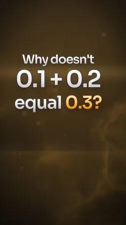</a><br /><sub><a href="examples/float-math"><b>Why does 0.1 + 0.2 not equal 0.3?</b></a><br />English · 35 s · captions · <a href="docs/media/films/float-math.mp4">▶ watch</a> · <a href="examples/float-math/storyboard">board</a></sub></td>
</tr>
<tr>
<td valign="top" align="center" width="170"><a href="docs/media/films/es-mengapung.mp4"></a><br /><sub><a href="examples/es-mengapung"><b>Kenapa es malah ngapung di air?</b></a><br />Bahasa Indonesia · 32 s · captions · <a href="docs/media/films/es-mengapung.mp4">▶ watch</a> · <a href="examples/es-mengapung/storyboard">board</a></sub></td>
</tr>
</table>

<sub>Every preview is a few seconds of the finished film, looping. Click one for the whole film (720p, sound on). 13 films, each made by an agent following this skill from the brief to the mix.</sub>
<!-- gallery:end -->

## How it works

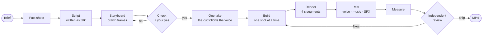

**The storyboard is the film's clock.** Shot starts and ends, captions and the chapter rail are read from it, and
its frames are drawn in the real frame's coordinates, so the build can be cut straight from them. The checker
refuses a board with too few pictures (one about every 3.2 s), a caption nobody could finish reading, a number with
no fact behind it, a line that will not fit its shot, a 3D object with no model sheet, or a short whose ending does
not loop. Full standard: [`references/storyboard.md`](references/storyboard.md).


<sub>Top: frames from the storyboard. Bottom: the same moments in the render.</sub>

**A film is a web page with one paused [GSAP](https://gsap.com) timeline.** The renderer opens it in headless
Chromium, seeks the timeline to every frame in turn, captures it and pipes the frames to FFmpeg, which adds bloom and
grain. Nothing reads the wall clock, so every frame is reproducible; anything GSAP cannot hold exactly (a canvas, a
shader, typed text) keeps its state in a plain object the timeline tweens. The picture is rendered in four-second
segments, so a fix re-renders only the seconds it touches.

**Narration is one take.** A film can explain with captions alone, or speak. When it speaks, the script is written
as talk, performed as one continuous take with [ElevenLabs](https://elevenlabs.io), and the picture is cut to the
voice; its word times light the captions as each word is said. A short loops: its last line runs into its first,
and the music runs on across the seam. How to write it: [`references/narration.md`](references/narration.md); how to
perform and cut it: [`references/voice.md`](references/voice.md).

**Sound is set by measurement.** A music bed composed to the film's length, effects on real events, each one's lift
over what plays before it measured in the finished mix, mastered to −14 LUFS with true peak under −1 dBFS.

## Rendering

There is one renderer and it takes the fastest drawing the machine has, with nothing to configure: **the GPU** when
there is one, otherwise **Mesa's lavapipe**, software Vulkan that spreads each frame over every CPU core.

| One heavy portrait frame (1080x1920, PBR, soft shadows, depth of field), on a CPU | Time per frame | Quality |
| --- | --- | --- |
| Chromium's own software renderer, `page.screenshot` | 7.1 s | the reference |
| Mesa lavapipe, frames captured through the DevTools protocol | 1.1 s | PSNR 44.7 dB, SSIM 0.995 |
| Depth of field that skips in-focus pixels and sizes its blur | the pass 245 → 125 ms | PSNR 45.4 dB, SSIM 0.997 |

On a CPU, heavy 3D draws at about a frame a second per four cores, so the kit can also render on a bigger machine:
a worker in Docker (a VPS, a home server, a Dokploy or Coolify host), capped in CPUs and memory so the host's other
services keep theirs. A 4 s, 1080x1920, 60 fps 3D test took **91 s on a 10-core worker** against 320 s on a busy
4-core machine.

```sh
# on the bigger machine: run kit/farm/compose.yml (set FARM_TOKEN; FARM_CPUS caps the cores), expose port 8080
FARM_URL=https://your-host/farm FARM_TOKEN=... node kit/tools/farm.mjs films/moon-face --segment 1
```

## The kit

<details>
<summary><b>What is in <code>kit/</code></b></summary>
<br />

| File | What it is |
| --- | --- |
| [`kit/engine/motion.js`](kit/engine/motion.js) | the film engine: one timeline, scenes, type, captions, chapters, whips, hits |
| [`kit/engine/stage.js`](kit/engine/stage.js) | the stage: one fragment shader of flowing light, a floor, dust, shock rings |
| [`kit/engine/stage3d.js`](kit/engine/stage3d.js) | the 3D layer: a directed camera, depth of field, soft shadows, pinned labels, exploded views, cutaways |
| [`kit/engine/parts3d.js`](kit/engine/parts3d.js) | materials with real surface and ready-made parts: boards, chips, drivers, mics, screws, a desk set |
| [`kit/tools/anatomy.mjs`](kit/tools/anatomy.mjs), [`kit/engine/body3d.js`](kit/engine/body3d.js) | real human anatomy (BodyParts3D): bones, muscles, skin; joints that bend, muscles that flex, skin that turns to glass |
| [`kit/engine/tissue3d.js`](kit/engine/tissue3d.js) | skeletal muscle from the whole muscle down to its molecules, at measured sizes |
| [`kit/engine/look.js`](kit/engine/look.js), [`backdrops.js`](kit/engine/backdrops.js) | the visual template applied before the first frame, held time for stepped looks, and the non-graphite stages |
| [`kit/engine/ink.js`](kit/engine/ink.js) | drawn looks: lines drawn on stroke by stroke, boiling, lettering written on, marker, chalk, wash, halftone, neon, cut paper |
| [`kit/engine/clay.js`](kit/engine/clay.js) | claymation: a tabletop set, plasticine with fingerprints, the stop-motion boil, rolled ropes, paper flags |
| [`kit/engine/clock.js`](kit/engine/clock.js) | the page clock from reanimate: seeded randomness and a virtual clock for timers, CSS animations and video |
| [`kit/css/film.css`](kit/css/film.css) | the look: tokens, glass, metal type, captions, panels, safe areas |
| [`kit/tools/storyboard.mjs`](kit/tools/storyboard.mjs), [`sketch.mjs`](kit/tools/sketch.mjs) | the storyboard check and the pencil board |
| [`kit/tools/render.mjs`](kit/tools/render.mjs) | frame-by-frame render in segments, stills, live preview |
| [`kit/tools/farm.mjs`](kit/tools/farm.mjs), [`kit/farm/`](kit/farm) | render on a bigger machine: the client, and the worker with its Docker Compose file |
| [`kit/audio/voice.mjs`](kit/audio/voice.mjs) | narration: one take, matched to the script word by word, and the film cut to it |
| [`kit/audio/music.mjs`](kit/audio/music.mjs) | a music bed composed for the film's length with ElevenLabs Music |
| [`kit/audio/mix.py`](kit/audio/mix.py) | the mixer: voice, music, effects, ducking, mastering, the loop seam, each effect's lift |
| [`kit/tools/check.mjs`](kit/tools/check.mjs), [`lookmatch.mjs`](kit/tools/lookmatch.mjs) | contact sheets, frozen time, loudness, the loop seam, and the look against its template |
| [`kit/tools/reference.mjs`](kit/tools/reference.mjs), [`analysis.mjs`](kit/tools/analysis.mjs) | studying a reference for a new template, and comparing what you built against it |
| [`kit/tools/make.mjs`](kit/tools/make.mjs), [`doctor.mjs`](kit/tools/doctor.mjs), [`test.mjs`](kit/tools/test.mjs) | the whole pipeline in one command, the environment check, and a smoke test |

```
motion-educator/
├── SKILL.md       the skill: what never bends, and the workflow
├── references/    teaching, storyboard, look, detail and camera, engine, motion, narration, voice, sound, review
├── kit/           the engine and its tools (copied into each workspace); kit/scaffold/ starts a new film
├── templates/     the visual templates: their lines, settings, type and golden stills
└── examples/      finished films with their storyboards, source and cue sheets
```

</details>

## Docs

| When you are… | Read |
| --- | --- |
| deciding what to teach and in what order | [`references/pedagogy.md`](references/pedagogy.md) |
| writing and drawing the storyboard | [`references/storyboard.md`](references/storyboard.md) |
| choosing the look, or making a portrait short | [`references/look.md`](references/look.md) |
| making a film in a visual template, or a new template | [`references/templates.md`](references/templates.md) |
| building a film with the kit, and rendering it fast | [`references/engine.md`](references/engine.md), [`references/motion.md`](references/motion.md) |
| building real objects in 3D and directing the camera | [`references/detail.md`](references/detail.md) |
| writing narration that sounds like talk | [`references/narration.md`](references/narration.md) |
| choosing a voice, performing the take, cutting to it | [`references/voice.md`](references/voice.md) |
| choosing music and placing sounds | [`references/sound.md`](references/sound.md) |
| checking a render and briefing a reviewer | [`references/review.md`](references/review.md) |

## Limitations

- **Nobody has heard the films.** The agent that makes them cannot listen: sound is chosen by description and set by
  measurement, and each delivery says what a person should listen for.
- **Rendering is slow without a GPU.** A minute of 1080p60 3D takes the better part of an hour on a small CPU-only
  machine; a GPU or a render worker brings it to minutes.
- **The sound library is not in the repository.** Library music and effects come from [Mixkit](https://mixkit.co),
  whose licence allows them inside a video but not passed on as files; `kit/audio/fetch.sh` downloads them.
- **Narration and composed music use credits** on your ElevenLabs account. Without a key, films use captions and a
  library track.
- **A replica is only as good as its references.** When good photographs of the real object cannot be found, the
  agent asks you for some; without them, it says what it could not match.

## Licence

[MIT](LICENSE). The films you make with it are yours: the licence covers this repository's code, documents and
examples, not what you render.

<details>
<summary><b>Third-party terms and credits</b></summary>
<br />

| Thing | Its terms | In this repository |
| --- | --- | --- |
| [GSAP](https://gsap.com) | GSAP's own no-charge licence (not MIT) | a dependency installed from npm, not redistributed |
| [three.js](https://threejs.org) | MIT | a dependency installed from npm |
| Sora, Inter, JetBrains Mono, Instrument Serif, Patrick Hand and the templates' faces | SIL Open Font License | installed from npm |
| Music and sound effects | [Mixkit](https://mixkit.co)'s licences: free inside a video, not to be passed on as files | not included; `kit/audio/fetch.sh` downloads them |
| Narration and composed music in the example films | generated with [ElevenLabs](https://elevenlabs.io); your rights depend on your own plan | included, so the examples can be re-mixed |
| Earth maps in the examples | NASA imagery, not copyrighted | included, with [sources](examples/langit-biru/assets/SOURCES.md) |

- [GSAP](https://gsap.com) and [three.js](https://threejs.org) do the animating and the 3D.
- The composition shape (a fixed-size root and one paused timeline at `window.__timelines.root`) follows
  [Null Motion](https://github.com/blixvip/NullMotion)'s HyperFrames convention.
- The page clock (`kit/engine/clock.js`) and the tools for making new templates (`kit/tools/reference.mjs`) come
  from [reanimate](https://github.com/NiazMorshed2007/reanimate) by Niaz Morshed, MIT
  ([licence](kit/engine/LICENSE-reanimate)).

</details>

<div align="center">
<br />
<sub>Built storyboard first · <a href="https://motionedu.kejaa.id">motionedu.kejaa.id</a></sub>
</div>
