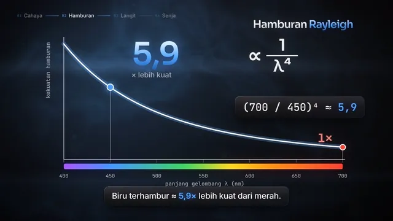
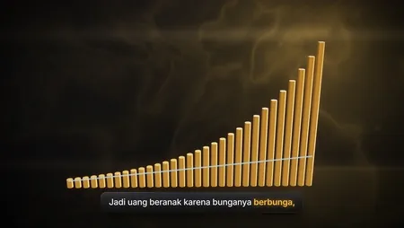
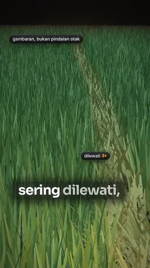
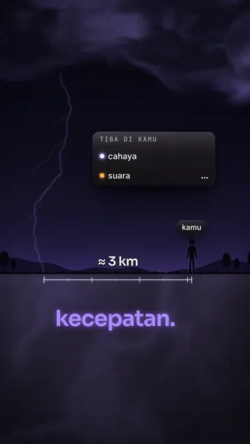
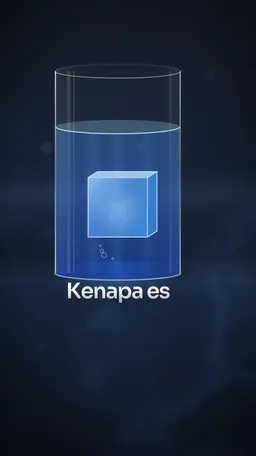

<div align="center">


# Motion Educator

**Educational films that look expensive, built in code, storyboard first.**

An agent skill and the film engine behind it. You ask for an explainer; it draws the storyboard, waits for your yes,
then renders a 1080p60 film frame by frame: detailed 3D replicas of real things shot by a directed camera, a lit
stage, glass, metal type, diagrams, captions, narration, music and sound effects.

[](https://github.com/zeative/motion-educator/actions/workflows/test.yml)


[](LICENSE)

[Quick start](#quick-start) · [How it works](#how-it-works) · [Gallery](#gallery) · [The kit](#the-kit) · [Docs](#docs)

<br />


<sub>Moments from films made with the skill, each by an agent following it from the brief to the mix. Every frame is code: no stock footage, no video model.</sub>

</div>

<br />

## Why

Most explainer videos made by an agent are slides with a voice. This one is held to a different standard:

- **It is planned before it is built.** Nothing is rendered until an illustrated storyboard passes a checker and
  you have seen it.
- **It is true.** Every number on screen sits in a fact sheet with its source and its arithmetic. A bar that
  stands for 5.9× is 5.9 times as tall.
- **It shows the real thing.** A device, an organ or a machine is built in 3D as a replica of the one the viewer
  knows, from reference photographs and teardowns, and filmed like a product: orbits, push-ins, macro close-ups,
  parts lifting apart, labels riding on the parts.
- **It explains itself on mute.** Captions carry the lesson; narration and sound make it land.
- **It is graded by someone else.** A reviewer that did not build the film judges the render, and the fixes are
  re-rendered a segment at a time.

## What you get

<table>
<tr>
<td width="33%" valign="top">

### 🎬 A film engine
One paused timeline is the only clock, so any frame can be drawn by seeking to it. No dropped frames, no
flicker, a fix re-renders four seconds, not the film, and the drawing runs on the GPU (or on every CPU core).

</td>
<td width="33%" valign="top">

### ✏️ A storyboard gate
Pencil frames for every shot, drawn in the real frame's coordinates, with what each shot teaches, shows, moves,
carries over and cites. A validator enforces the standard.

</td>
<td width="33%" valign="top">

### 🔊 Sound by measurement
Narration through ElevenLabs, a music bed whose beat the cuts sit on, effects on real events, mastered to
−14 LUFS and measured on the encoded file.

</td>
</tr>
<tr>
<td valign="top">

### 📐 Two formats
`1920x1080` for lessons, `1080x1920` for shorts, from one field in the storyboard. A short gets safe areas for app
chrome, captions lit word by word, and an ending that loops back into its start.

</td>
<td valign="top">

### 🎥 Real objects, a directed camera
3D replicas built from a model sheet (reference, parts, real sizes) with a parts kit and materials that have
surface; a camera that orbits, pushes in and racks focus; exploded views, cutaways, pinned labels.

</td>
<td valign="top">

### 🔍 A review loop
Stills while building, contact sheets and frozen-time checks after rendering, then independent critics with
ready-made briefs. Their lessons are written back into the skill.

</td>
</tr>
</table>

## Storyboard first

The storyboard is not a sketch of intentions. It is the source of time for the film: shot starts and ends, captions
and the chapter rail are read from it, and the frames are drawn where the pixels will be.


<sub>Top: frames from the storyboard. Bottom: the same moments in the render.</sub>

The checker refuses a storyboard that has too few pictures (one about every 3.2 s), a shot drawn only once, a
caption nobody could finish reading, a number with no fact behind it, a spoken line that will not fit its shot,
three shots of the same kind in a row, a 3D object with no model sheet (which real version, from which reference,
with which parts), a 3D shot with no camera move, or a short whose ending does not loop. Full standard: [`references/storyboard.md`](references/storyboard.md).

## Quick start

### As a skill

```sh
git clone https://github.com/zeative/motion-educator ~/.claude/skills/motion-educator
```

It is a plain [Agent Skills](https://agentskills.io) folder (`SKILL.md`, `references/`, a Node kit), so any agent
that reads skills can use it. Clone it into the folder yours looks in:

| Agent | For you (all projects) | For one project |
| --- | --- | --- |
| Claude Code | `~/.claude/skills/motion-educator` | `.claude/skills/motion-educator` |
| OpenAI Codex | `~/.agents/skills/motion-educator` | `.agents/skills/motion-educator` |
| Gemini CLI | `~/.gemini/skills/motion-educator` | `.gemini/skills/motion-educator` |
| GitHub Copilot (CLI, cloud agent, VS Code agent mode) | `~/.copilot/skills/motion-educator` | `.github/skills/motion-educator` |
| Cursor | reads `~/.claude/skills` and `~/.codex/skills` | `.cursor/skills/motion-educator` |

An agent without skill support can still follow it: clone it anywhere and tell it to read `SKILL.md` there first.
What the agent needs: a shell to run Node, FFmpeg and Python, and the ability to look at images, since it checks its
own stills and contact sheets. Every film in this repository was made with Claude Code; the others are untested here.

Then ask your agent for a film:

> Make a 45-second explainer on why the Moon always shows us the same face. Portrait, English, with narration.

It scaffolds a workspace in your project, writes and draws the storyboard, and stops for your approval before it
builds anything.

### By hand

```sh
git clone https://github.com/zeative/motion-educator && cd motion-educator
npm install && bash kit/audio/fetch.sh
node kit/tools/doctor.mjs                                # is this machine ready?

node kit/tools/new.mjs ~/films moon-face --portrait      # a workspace and films/moon-face
cd ~/films && npm install && bash kit/audio/fetch.sh
```

```sh
# 1. Write films/moon-face/storyboard.json, then check it and draw the board
node kit/tools/storyboard.mjs films/moon-face --png

# 2. Record the narration (optional) and let it set the shot lengths
node kit/audio/voice.mjs films/moon-face --generate      # one take, and the film cut to it (ELEVENLABS_API_KEY)

# 3. Build index.html, film.css and film.js, looking at stills as you go
node kit/tools/render.mjs films/moon-face --stills 1.5,4.2 --safe
node kit/tools/render.mjs films/moon-face --serve        # watch it live

# 4. Everything else, in order: render, mix, measure, a share copy
node kit/tools/make.mjs films/moon-face
```

Requirements: Node 20+, FFmpeg, Python 3 with numpy, and Playwright's Chromium
(`npm i -D playwright && npx playwright install chromium`). The renderer uses the GPU when there is one; on a Linux
machine without one it needs Mesa's software Vulkan (`apt install mesa-vulkan-drivers`). `node kit/tools/doctor.mjs`
checks all of it. See [Rendering](#rendering).

## Rendering

Every frame is drawn by seeking the timeline in headless Chromium, so nothing is ever dropped, and the picture is
cut into four-second segments so a fix re-renders only the seconds it touches. There is one renderer and it takes
the fastest drawing the machine has, with nothing to configure: **the GPU** when there is one (any Mac or Windows
machine, Linux with a GPU), otherwise **Mesa's lavapipe**, software Vulkan that spreads each frame over every CPU
core. It prints which one it got.

Measured on one heavy portrait frame (1080x1920, PBR materials, soft shadows, depth of field), on a CPU:

| | Time per frame | Quality |
| --- | --- | --- |
| Before: Chromium's own software renderer, `page.screenshot` | 7.1 s | the reference |
| Now: Mesa lavapipe, frames captured through the DevTools protocol | 1.1 s | PSNR 44.7 dB, SSIM 0.995 against the reference |
| Now: depth of field that skips in-focus pixels and sizes its blur | the pass 245 → 125 ms | PSNR 45.4 dB, SSIM 0.997 |

On a CPU about nine tenths of a frame is the 3D drawing itself, and it scales with cores. So the kit can also
**render on a bigger machine**: a render worker runs in Docker anywhere you have room (a VPS, a home server, a
Dokploy or Coolify host), with a CPU limit so the machine's other services keep theirs.

```sh
# on the bigger machine: run kit/farm/compose.yml (set FARM_TOKEN; FARM_CPUS caps the cores), expose port 8080
# then, from your workspace:
FARM_URL=https://your-host/farm FARM_TOKEN=... node kit/tools/farm.mjs films/moon-face --segment 1
```

It packs the kit and the film (with the segments already finished), sends them, follows the worker's log, and
brings `out/picture.mp4` back; later fixes with `--only` render only what changed there too. Measured: a 4 s,
1080x1920, 60 fps 3D test took **91 s on a 10-core worker** against 320 s on a busy 4-core machine. For a long
film at 60 fps, a GPU is still the way to minutes; a short at 30 fps renders in minutes on a worker.

## How it works


A film is a web page with one paused [GSAP](https://gsap.com) timeline. The renderer opens it in headless Chromium
(WebGL on the GPU, or Mesa lavapipe without one), seeks the timeline to every frame in turn, captures it, and pipes
the frames to FFmpeg, which adds bloom and grain. Four browsers render four-second segments in parallel; each
segment is its own file, so changing one shot re-renders only the segments it touches. A render worker on a bigger
machine can take the segments instead ([Rendering](#rendering)).

Anything GSAP cannot hold exactly (a canvas, a shader, typed text, a dash offset) keeps its state in a plain object
that the timeline tweens and a per-frame job draws. Nothing reads the wall clock, which is what makes every frame
reproducible.

## Gallery

<!-- gallery:start -->
**Explainers** (16:9)

<table>
<tr>
<td valign="top" align="center" width="300"><a href="docs/media/films/langit-biru.mp4"></a><br /><sub><a href="examples/langit-biru"><b>Kenapa langit berwarna biru?</b></a><br />Bahasa Indonesia · 67 s · captions · <a href="docs/media/films/langit-biru.mp4">▶ watch</a> · <a href="examples/langit-biru/storyboard">board</a></sub></td>
<td valign="top" align="center" width="300"><a href="docs/media/films/how-gps-works.mp4"></a><br /><sub><a href="examples/how-gps-works"><b>How does your phone know where you are?</b></a><br />English · 60 s · captions · <a href="docs/media/films/how-gps-works.mp4">▶ watch</a> · <a href="examples/how-gps-works/storyboard">board</a></sub></td>
</tr>
<tr>
<td valign="top" align="center" width="300"><a href="docs/media/films/why-seasons.mp4"></a><br /><sub><a href="examples/why-seasons"><b>Why do we have seasons?</b></a><br />English · 57 s · captions · <a href="docs/media/films/why-seasons.mp4">▶ watch</a> · <a href="examples/why-seasons/storyboard">board</a></sub></td>
<td valign="top" align="center" width="300"><a href="docs/media/films/bunga-majemuk.mp4"></a><br /><sub><a href="examples/bunga-majemuk"><b>Kok uang bisa beranak? Gimana bunga majemuk bekerja?</b></a><br />Bahasa Indonesia · 52 s · captions · <a href="docs/media/films/bunga-majemuk.mp4">▶ watch</a> · <a href="examples/bunga-majemuk/storyboard">board</a></sub></td>
</tr>
</table>

**Shorts** (9:16)

<table>
<tr>
<td valign="top" align="center" width="170"><a href="docs/media/films/luka-sembuh.mp4"></a><br /><sub><a href="examples/luka-sembuh"><b>Gimana sih luka bisa nutup sendiri?</b></a><br />Bahasa Indonesia · 53 s · voice: Livna · <a href="docs/media/films/luka-sembuh.mp4">▶ watch</a> · <a href="examples/luka-sembuh/storyboard">board</a></sub></td>
<td valign="top" align="center" width="170"><a href="docs/media/films/hoaks-diulang.mp4"></a><br /><sub><a href="examples/hoaks-diulang"><b>Kenapa hoaks yang diulang-ulang lama-lama terasa benar?</b></a><br />Bahasa Indonesia · 50 s · voice: Jefri · <a href="docs/media/films/hoaks-diulang.mp4">▶ watch</a> · <a href="examples/hoaks-diulang/storyboard">board</a></sub></td>
<td valign="top" align="center" width="170"><a href="docs/media/films/hp-lemot.mp4"></a><br /><sub><a href="examples/hp-lemot"><b>Kenapa HP makin lemot pas memorinya hampir penuh?</b></a><br />Bahasa Indonesia · 45 s · voice: Rafiq · <a href="docs/media/films/hp-lemot.mp4">▶ watch</a> · <a href="examples/hp-lemot/storyboard">board</a></sub></td>
<td valign="top" align="center" width="170"><a href="docs/media/films/petir-guntur.mp4"></a><br /><sub><a href="examples/petir-guntur"><b>Kenapa petir terlihat dulu, baru guntur terdengar?</b></a><br />Bahasa Indonesia · 40 s · voice: Rafiq · <a href="docs/media/films/petir-guntur.mp4">▶ watch</a> · <a href="examples/petir-guntur/storyboard">board</a></sub></td>
</tr>
<tr>
<td valign="top" align="center" width="170"><a href="docs/media/films/float-math.mp4"></a><br /><sub><a href="examples/float-math"><b>Why does 0.1 + 0.2 not equal 0.3?</b></a><br />English · 35 s · captions · <a href="docs/media/films/float-math.mp4">▶ watch</a> · <a href="examples/float-math/storyboard">board</a></sub></td>
<td valign="top" align="center" width="170"><a href="docs/media/films/es-mengapung.mp4"></a><br /><sub><a href="examples/es-mengapung"><b>Kenapa es malah ngapung di air?</b></a><br />Bahasa Indonesia · 32 s · captions · <a href="docs/media/films/es-mengapung.mp4">▶ watch</a> · <a href="examples/es-mengapung/storyboard">board</a></sub></td>
</tr>
</table>

<sub>Every preview is a few seconds of the finished film, looping. Click one for the whole film (720p, sound on). 10 films, each made by an agent following this skill from the brief to the mix.</sub>
<!-- gallery:end -->

## Narration

A film can explain with captions alone, or speak. When it speaks, it is written as one piece of talk, performed as
one continuous take with [ElevenLabs](https://elevenlabs.io), and the picture is cut to the voice: a shot starts
just before its first word, and the performer's own pauses are kept. The take's word times drive captions that
light up as each word is said, and the mixer runs the voice through a de-esser and compression and pulls the music
down under it.

```json
{
  "voice": { "voice_id": "…", "name": "Jefri", "model": "eleven_v4", "language": "id", "direction": "[warmly]" },
  "shots": [
    { "id": "s01", "voice": "Kenapa sih kilat selalu kelihatan duluan, baru gunturnya nyusul?" },
    { "id": "s02", "voice": "Padahal dua-duanya muncul barengan, lho.", "caption": "muncul *barengan*" }
  ]
}
```

A short loops: its last line is the first half of a sentence its first line finishes, its last frame is its first
shot's picture a moment early, and the music runs on across the seam, so a replay feels like the same film going
on. The mixer measures the pause at the seam and the checker compares the two frames.

The storyboard check reads the script as a listener would: sentences too long for the ear, clipped sentences in a
row, digits in a spoken line, textbook Indonesian ("tidak", "hanya", "oleh karena itu") and phrases that give a
machine away. How to write it: [`references/narration.md`](references/narration.md). How to perform and cut it:
[`references/voice.md`](references/voice.md).

## The kit

| File | What it is |
| --- | --- |
| [`kit/engine/motion.js`](kit/engine/motion.js) | the film engine: one timeline, scenes, type, captions, chapters, whips, hits |
| [`kit/engine/stage.js`](kit/engine/stage.js) | the stage: one fragment shader of flowing light, a floor, dust, shock rings |
| [`kit/engine/stage3d.js`](kit/engine/stage3d.js) | the 3D layer: a directed camera, depth of field, soft shadows, pinned labels, exploded views, cutaways |
| [`kit/engine/parts3d.js`](kit/engine/parts3d.js) | materials with real surface and ready-made parts: boards, chips, drivers, mics, screws, a desk set |
| [`kit/css/film.css`](kit/css/film.css) | the look: tokens, glass, metal type, captions, panels, safe areas |
| [`kit/tools/storyboard.mjs`](kit/tools/storyboard.mjs), [`sketch.mjs`](kit/tools/sketch.mjs) | the storyboard check and the pencil board |
| [`kit/tools/render.mjs`](kit/tools/render.mjs) | frame-by-frame render in segments, stills, live preview; on the GPU, or Mesa lavapipe without one |
| [`kit/tools/farm.mjs`](kit/tools/farm.mjs), [`kit/farm/`](kit/farm) | render on a bigger machine: the client, and the worker with its Docker Compose file |
| [`kit/audio/voice.mjs`](kit/audio/voice.mjs) | narration: one take, matched to the script word by word, and the film cut to it |
| [`kit/audio/music.mjs`](kit/audio/music.mjs) | a music bed composed for the film's length with ElevenLabs Music, and its status |
| [`kit/audio/mix.py`](kit/audio/mix.py) | the mixer: voice, music, effects, ducking, mastering, the loop seam, measurement |
| [`kit/tools/check.mjs`](kit/tools/check.mjs) | contact sheets, frozen time, loudness, the loop seam |
| [`kit/tools/make.mjs`](kit/tools/make.mjs) | the whole pipeline in one command |
| [`kit/tools/doctor.mjs`](kit/tools/doctor.mjs), [`test.mjs`](kit/tools/test.mjs) | environment check and a smoke test of everything above |

```
motion-educator/
├── SKILL.md            the skill: what never bends, and the workflow
├── references/         how to teach on screen, storyboard, look, detail and camera, engine, motion, narration, voice, sound, review
├── kit/                the engine and its tools (copied into each workspace)
├── templates/film/     what a new film starts from
└── examples/           finished films with their storyboards, source and cue sheets
```

## Docs

| When you are… | Read |
| --- | --- |
| deciding what to teach and in what order | [`references/pedagogy.md`](references/pedagogy.md) |
| writing and drawing the storyboard | [`references/storyboard.md`](references/storyboard.md) |
| choosing the look, or making a portrait short | [`references/look.md`](references/look.md) |
| building a film with the kit, and rendering it fast | [`references/engine.md`](references/engine.md), [`references/motion.md`](references/motion.md) |
| building real objects in 3D and directing the camera | [`references/detail.md`](references/detail.md) |
| writing narration that sounds like talk | [`references/narration.md`](references/narration.md) |
| choosing a voice, performing the take, cutting to it | [`references/voice.md`](references/voice.md) |
| choosing music and placing sounds | [`references/sound.md`](references/sound.md) |
| checking a render and briefing a reviewer | [`references/review.md`](references/review.md) |

## Honest limits

- **Nobody has heard the films.** The agent that makes them cannot listen: sound is chosen by description and set
  by measurement, and each delivery says what a person should listen for.
- **Rendering is slow without a GPU.** On a CPU, heavy 3D draws at about one frame a second per four cores, so a
  minute of 1080p60 takes the better part of an hour on a small machine. A GPU, or a render worker on a machine
  with more cores ([Rendering](#rendering)), is the way to minutes.
- **The sound library is not in the repository.** Music and effects come from [Mixkit](https://mixkit.co), whose
  licence allows them inside a video but not passed on as files; `kit/audio/fetch.sh` downloads them.
- **Narration and composed music cost credits** on your ElevenLabs account.
- **A replica is only as good as its references.** When good photographs of the real object cannot be found, the
  agent asks you for some; without them, it says what it could not match.

## Licence

[MIT](LICENSE). The films you make with it are yours: the licence covers this repository's code, documents and
examples, not what you render.

What is not ours to license, and how it is handled:

| Thing | Its terms | In this repository |
| --- | --- | --- |
| [GSAP](https://gsap.com) | GSAP's own no-charge licence (not MIT) | a dependency installed from npm, not redistributed |
| [three.js](https://threejs.org) | MIT | a dependency installed from npm |
| Sora, Inter, JetBrains Mono, Instrument Serif, Patrick Hand | SIL Open Font License | installed from npm |
| Music and sound effects | [Mixkit](https://mixkit.co)'s licences: free inside a video, not to be passed on as files | not included; `kit/audio/fetch.sh` downloads them |
| Narration in the example films | generated with [ElevenLabs](https://elevenlabs.io); your rights to voices you generate depend on your own plan | the examples' recordings are included so they can be re-mixed |
| Earth maps in the examples | NASA imagery, not copyrighted | included, with [sources](examples/langit-biru/assets/SOURCES.md) |

## Credits

- [GSAP](https://gsap.com) and [three.js](https://threejs.org) do the animating and the 3D.
- Fonts: Sora, Inter, JetBrains Mono, Instrument Serif and Patrick Hand (SIL Open Font License), from npm.
- The Earth in the worked example uses NASA's Blue Marble and Earth at Night maps, which are not copyrighted
  ([sources](examples/langit-biru/assets/SOURCES.md)).
- The composition shape (a fixed-size root and one paused timeline at `window.__timelines.root`) follows
  [Null Motion](https://github.com/blixvip/NullMotion)'s HyperFrames convention.

<div align="center">
<br />
<sub>Built storyboard first.</sub>
</div>
