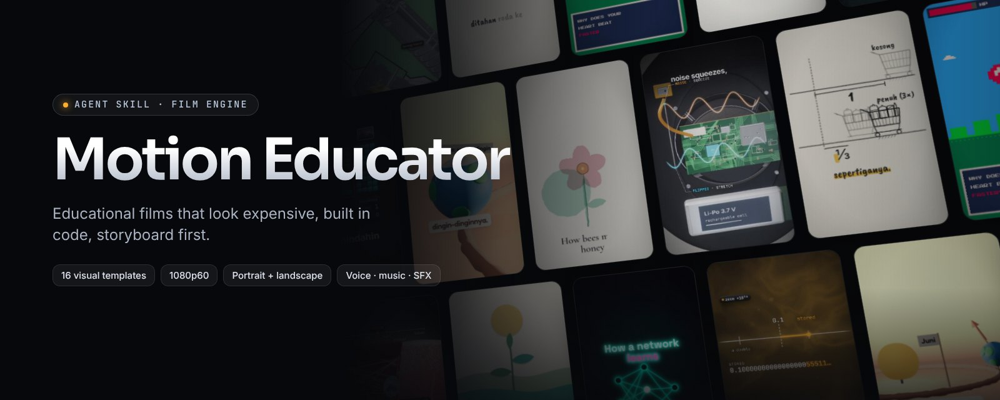
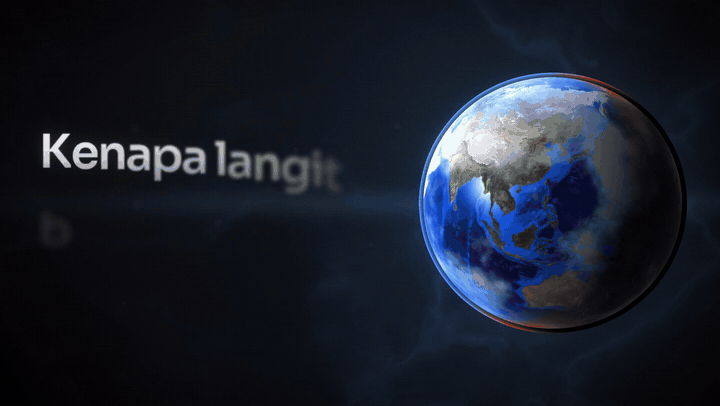
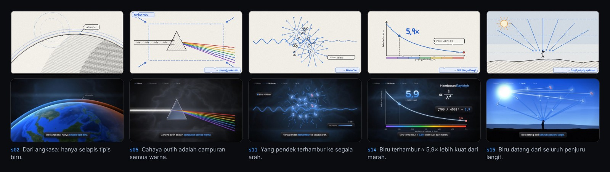
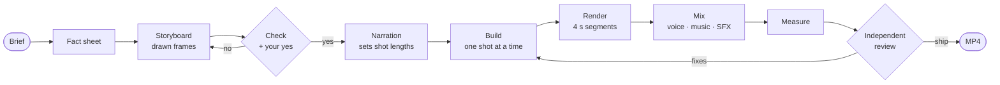
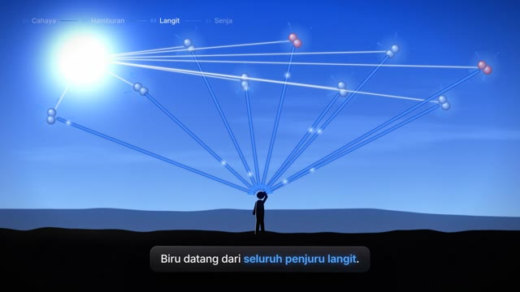

<div align="center">



# Motion Educator

**Educational films that look expensive, built in code, storyboard first.**

An agent skill and the film engine behind it. You ask for an explainer; it draws the storyboard, waits for your yes,
then renders a 1080p60 film frame by frame: lit stage, glass, metal type, 3D, diagrams, captions, narration, music
and sound effects.

[](https://github.com/zeative/motion-educator/actions/workflows/test.yml)


[](LICENSE)

[Quick start](#quick-start) · [How it works](#how-it-works) · [Gallery](#gallery) · [The kit](#the-kit) · [Docs](#docs)

<br />



<sub>From <a href="examples/langit-biru">“Kenapa langit berwarna biru?”</a> (67 s, Indonesian). Every frame is code: no stock footage, no video model.</sub>

</div>

<br />

## Why

Most explainer videos made by an agent are slides with a voice. This one is held to a different standard:

- **It is planned before it is built.** Nothing is rendered until an illustrated storyboard passes a checker and
  you have seen it.
- **It is true.** Every number on screen sits in a fact sheet with its source and its arithmetic. A bar that
  stands for 5.9× is 5.9 times as tall.
- **It explains itself on mute.** Captions carry the lesson; narration and sound make it land.
- **It is graded by someone else.** A reviewer that did not build the film judges the render, and the fixes are
  re-rendered a segment at a time.

## What you get

<table>
<tr>
<td width="33%" valign="top">

### 🎬 A film engine
One paused timeline is the only clock, so any frame can be drawn by seeking to it. No dropped frames, no
flicker, and a fix re-renders four seconds, not the film.

</td>
<td width="33%" valign="top">

### ✏️ A storyboard gate
Pencil frames for every shot, drawn in the real frame's coordinates, with what each shot teaches, shows, moves,
carries over and cites. A validator enforces the standard.

</td>
<td width="33%" valign="top">

### 🔊 Sound by measurement
Narration through ElevenLabs, a music bed whose beat the cuts sit on, effects on real events, mastered to
−14 LUFS and measured on the encoded file.

</td>
</tr>
<tr>
<td valign="top">

### 📐 Two formats
`1920x1080` for lessons, `1080x1920` for shorts, from one field in the storyboard. Portrait gets safe areas for
app chrome and word-by-word captions.

</td>
<td valign="top">

### 💎 A look that reads as real
A shader stage with a key light and a floor, glass panels, metal type with a travelling sheen, PBR materials,
bloom and grain in a finishing pass.

</td>
<td valign="top">

### 🔍 A review loop
Stills while building, contact sheets and frozen-time checks after rendering, then independent critics with
ready-made briefs. Their lessons are written back into the skill.

</td>
</tr>
</table>

## Storyboard first

The storyboard is not a sketch of intentions. It is the source of time for the film: shot starts and ends, captions
and the chapter rail are read from it, and the frames are drawn where the pixels will be.



<sub>Top: frames from the storyboard. Bottom: the same moments in the render.</sub>

The checker refuses a storyboard that has too few pictures (one about every 3.2 s), a shot drawn only once, a
caption nobody could finish reading, a number with no fact behind it, a spoken line that will not fit its shot, or
three shots of the same kind in a row. Full standard: [`references/storyboard.md`](references/storyboard.md).

## Quick start

### As a skill

```sh
git clone https://github.com/zeative/motion-educator ~/.claude/skills/motion-educator
```

Then ask your agent for a film:

> Make a 45-second explainer on why the Moon always shows us the same face. Portrait, English, with narration.

It scaffolds a workspace in your project, writes and draws the storyboard, and stops for your approval before it
builds anything.

### By hand

```sh
git clone https://github.com/zeative/motion-educator && cd motion-educator
npm install && sh kit/audio/fetch.sh
node kit/tools/doctor.mjs                                # is this machine ready?

node kit/tools/new.mjs ~/films moon-face --portrait      # a workspace and films/moon-face
cd ~/films && npm install && sh kit/audio/fetch.sh
```

```sh
# 1. Write films/moon-face/storyboard.json, then check it and draw the board
node kit/tools/storyboard.mjs films/moon-face --png

# 2. Record the narration (optional) and let it set the shot lengths
node kit/audio/voice.mjs films/moon-face --generate      # needs ELEVENLABS_API_KEY

# 3. Build index.html, film.css and film.js, looking at stills as you go
node kit/tools/render.mjs films/moon-face --stills 1.5,4.2 --safe
node kit/tools/render.mjs films/moon-face --serve        # watch it live

# 4. Everything else, in order: render, mix, measure, a share copy
node kit/tools/make.mjs films/moon-face
```

Requirements: Node 20+, FFmpeg, Python 3 with numpy, and Playwright's Chromium
(`npm i -D playwright && npx playwright install chromium`). No GPU needed; software WebGL renders about two frames
a second, so a minute of film takes around half an hour.

## How it works



A film is a web page with one paused [GSAP](https://gsap.com) timeline. The renderer opens it in headless Chromium,
seeks the timeline to every frame in turn, screenshots it, and pipes the frames to FFmpeg, which adds bloom and
grain. Four browsers render four-second segments in parallel; each segment is its own file, so changing one shot
re-renders only the segments it touches.

Anything GSAP cannot hold exactly (a canvas, a shader, typed text, a dash offset) keeps its state in a plain object
that the timeline tweens and a per-frame job draws. Nothing reads the wall clock, which is what makes every frame
reproducible.

## Gallery

<!-- gallery:start -->
| | Film | Format | Language | Narration |
| --- | --- | --- | --- | --- |
|  | [**Kenapa langit berwarna biru?**](examples/langit-biru)<br/>Rayleigh scattering in 67 seconds: 22 shots, 63 storyboard frames, 9 sourced facts. | 1920×1080 | Indonesian | captions only |
<!-- gallery:end -->

## Narration

A film can explain with captions alone, or speak. When it speaks, the voice sets the clock: each shot gets its line
in the storyboard, the lines are recorded with [ElevenLabs](https://elevenlabs.io), and the measured length of each
decides how long its shot runs. Captions then keep time with the voice, and the mixer lowers the music while
someone is talking.

```json
{
  "voice": { "voice_id": "…", "name": "Jefri", "model": "eleven_multilingual_v2", "language": "id" },
  "shots": [{ "id": "s03", "voice": "Padahal, cahaya Matahari itu putih.", "caption": "Cahaya Matahari itu *putih*." }]
}
```

With an API key, `voice.mjs --generate` records every line and keeps the time of each word. Without one, an agent
with an ElevenLabs connector records from `voice.mjs --script` and hands each file back with `--add`. Details:
[`references/voice.md`](references/voice.md).

## The kit

| File | What it is |
| --- | --- |
| [`kit/engine/motion.js`](kit/engine/motion.js) | the film engine: one timeline, scenes, type, captions, chapters, whips, hits |
| [`kit/engine/stage.js`](kit/engine/stage.js) | the stage: one fragment shader of flowing light, a floor, dust, shock rings |
| [`kit/engine/stage3d.js`](kit/engine/stage3d.js) | a three.js layer with a studio environment and materials that read as real |
| [`kit/css/film.css`](kit/css/film.css) | the look: tokens, glass, metal type, captions, panels, safe areas |
| [`kit/tools/storyboard.mjs`](kit/tools/storyboard.mjs), [`sketch.mjs`](kit/tools/sketch.mjs) | the storyboard check and the pencil board |
| [`kit/tools/render.mjs`](kit/tools/render.mjs) | frame-by-frame render in segments, stills, live preview |
| [`kit/audio/voice.mjs`](kit/audio/voice.mjs) | narration: record, measure, check each line fits its shot |
| [`kit/audio/mix.py`](kit/audio/mix.py) | the mixer: voice, music, effects, ducking, mastering, measurement |
| [`kit/tools/check.mjs`](kit/tools/check.mjs) | contact sheets, frozen time, loudness |
| [`kit/tools/make.mjs`](kit/tools/make.mjs) | the whole pipeline in one command |
| [`kit/tools/doctor.mjs`](kit/tools/doctor.mjs), [`test.mjs`](kit/tools/test.mjs) | environment check and a smoke test of everything above |

```
motion-educator/
├── SKILL.md            the skill: what never bends, and the workflow
├── references/         how to teach on screen, storyboard, look, engine, motion, voice, sound, review
├── kit/                the engine and its tools (copied into each workspace)
├── templates/film/     what a new film starts from
└── examples/           finished films with their storyboards, source and cue sheets
```

## Docs

| When you are… | Read |
| --- | --- |
| deciding what to teach and in what order | [`references/pedagogy.md`](references/pedagogy.md) |
| writing and drawing the storyboard | [`references/storyboard.md`](references/storyboard.md) |
| choosing the look, or making a portrait short | [`references/look.md`](references/look.md) |
| building a film with the kit | [`references/engine.md`](references/engine.md), [`references/motion.md`](references/motion.md) |
| writing and recording narration | [`references/voice.md`](references/voice.md) |
| choosing music and placing sounds | [`references/sound.md`](references/sound.md) |
| checking a render and briefing a reviewer | [`references/review.md`](references/review.md) |
| rendering with raea instead of the browser | [`references/raea.md`](references/raea.md) |

## Honest limits

- **Nobody has heard the films.** The agent that makes them cannot listen: sound is chosen by description and set
  by measurement, and each delivery says what a person should listen for.
- **Rendering is slow without a GPU**: about half an hour for a minute of 1080p60.
- **The sound library is not in the repository.** Music and effects come from [Mixkit](https://mixkit.co), whose
  licence allows them inside a video but not passed on as files; `kit/audio/fetch.sh` downloads them.
- **Narration costs credits** on your ElevenLabs account.

## Licence

[MIT](LICENSE). The films you make with it are yours: the licence covers this repository's code, documents and
examples, not what you render.

What is not ours to license, and how it is handled:

| Thing | Its terms | In this repository |
| --- | --- | --- |
| [GSAP](https://gsap.com) | GSAP's own no-charge licence (not MIT) | a dependency installed from npm, not redistributed |
| [three.js](https://threejs.org) | MIT | a dependency installed from npm |
| Sora, Inter, JetBrains Mono, Instrument Serif, Patrick Hand | SIL Open Font License | installed from npm |
| Music and sound effects | [Mixkit](https://mixkit.co)'s licences: free inside a video, not to be passed on as files | not included; `kit/audio/fetch.sh` downloads them |
| Narration in the example films | generated with [ElevenLabs](https://elevenlabs.io); your rights to voices you generate depend on your own plan | the examples' recordings are included so they can be re-mixed |
| Earth maps in the examples | NASA imagery, not copyrighted | included, with [sources](examples/langit-biru/assets/SOURCES.md) |

## Credits

- [GSAP](https://gsap.com) and [three.js](https://threejs.org) do the animating and the 3D.
- Fonts: Sora, Inter, JetBrains Mono, Instrument Serif and Patrick Hand (SIL Open Font License), from npm.
- The Earth in the worked example uses NASA's Blue Marble and Earth at Night maps, which are not copyrighted
  ([sources](examples/langit-biru/assets/SOURCES.md)).
- The composition shape (a fixed-size root and one paused timeline at `window.__timelines.root`) follows
  [Null Motion](https://github.com/blixvip/NullMotion)'s HyperFrames convention.
- [raea](https://raea.io) is covered as an alternative renderer, with a proof shot in
  [`examples/raea-proof`](examples/raea-proof).

<div align="center">
<br />
<sub>Built storyboard first.</sub>
</div>
